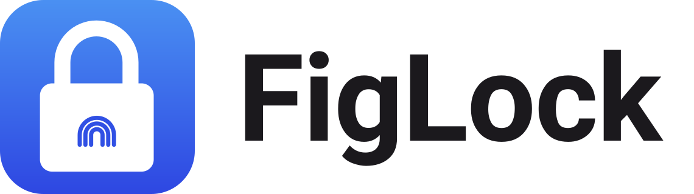

<p align="center">
  <picture>
    <source media="(prefers-color-scheme: dark)" srcset="design/logo/lockups/figlock-lockup-horizontal-on-dark.svg">
    
  </picture>
</p>

# FigLock

A headless, agent-aware password manager. One encrypted vault for passwords, API tokens and secrets,
usable from CLI, desktop, web, browser extension and native mobile apps, with no backend or database of
our own. Your vault lives as ciphertext in storage you already own (Google Drive, iCloud Drive, later Git
and S3). AI agents can *use* a secret after you approve with Touch ID, without ever seeing it.

**Status:** early development, current release v0.2.0. The `figlock` CLI can create a vault in a local folder or in Google Drive, add, edit, find, get, copy, generate, export and import items, change the master password, rotate the Secret Key, revoke a device, and let an agent use a secret through the broker (`figlock --help`). Do not store real secrets in anything from this repo
until the security audit (phase 6) is done.

- What we're building: [docs/prd.md](docs/prd.md)
- What's decided: [docs/decisions.md](docs/decisions.md)
- Why: [docs/research.md](docs/research.md)
- How to work on it (humans and agents): [AGENTS.md](AGENTS.md)

## Install

macOS (Homebrew):

```sh
brew install figlock/tap/figlock
```

macOS or Linux (x86_64 and aarch64):

```sh
curl -fsSL https://figlock.com/install.sh | sh
```

The installer checks the download against the release's `SHA256SUMS` and installs to `~/.local/bin`. The macOS
binary is signed and notarized. The Linux builds are static and are published but have had little testing so far.
Then run `figlock --help`.

Website: [figlock.com](https://figlock.com).

## License

Dual-licensed under MIT OR Apache-2.0, at your option.
